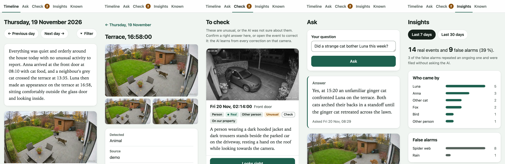

# Camera diary

Home cameras send dozens of notifications a day, and many of them are a spider in front of the lens. Camera diary turns every clip into a diary entry instead: an AI looks at the frames, says whether anything real happened and who it was, learns from your corrections, and answers your questions in plain words.

> Did a strange cat bother Luna this week?
> How often was Luna outside in the last seven days?
> Which camera has the most false alarms, and why?



Built with [Symfony AI](https://symfony.com/doc/current/ai/index.html) and the [PHP MCP SDK](https://github.com/modelcontextprotocol/php-sdk) for the [Symfony AI & MCP Hackathon](https://symfony.com/hackathon).

- **Real or false alarm.** Every event gets a verdict, the cause of a false alarm (spider web, insect, rain, light, wind), where it happened, and a short description. The AI compares the frames with the camera's usual empty view in the same light, so a new spider web or a shape at the hedge stands out.
- **No AI call for the same spider all night.** Once a camera's last two false alarms within three hours had the same cause (a cat crossing in between does not count), a new event on that camera is compared with them pixel by pixel. If only the spider's thread moved, it is filed as a repeat without asking the AI; anything new still goes to the AI, and every two hours one does anyway.
- **Your cat by name.** Name your cat or the people who live with you, and drag a box around them in any frame to add a reference photo. Events then read "Luna", and every other cat "Other cat".
- **It learns from you.** Unusual and unsure events land on the "Check" page. One tap confirms them, and every correction (verdict, cause, who it was, a label) goes into the next prompts for that camera, so the same mistake does not come back.
- **Questions with sources.** The AI turns a question into a search (who, where, when), reads every event of that time span, looks at the best matches' frames, and answers with the events it relies on. Questions are kept, with a link to share.
- **Assistants included.** An MCP server lets Claude, Home Assistant Assist or any MCP client search the events, look at the frames themselves, get exact counts, and correct an event ("that was Luna").
- **Insights and a daily summary.** Who came by and when, which camera raises false alarms and why, and the day in a few sentences.
- **Any camera, any AI.** Anything that can send a video or an image posts it to one hook; a Home Assistant add-on cuts frames from continuous recordings. Gemini, Vertex AI or Ollama through their APIs, or Claude Code and Codex through the subscription you are already logged in to.
- **Your words.** Detection types, subjects and false-alarm causes are lists in a settings file: add a fox or a parcel, and the AI's output schema and the app use it.

## What Symfony AI and the MCP SDK made possible

- **One structured output, five providers.** The AI's answer is a PHP class (`EventDescriptionOutput`). Symfony AI turns it into a JSON schema, and a decorated response format factory fills its `enum`s from the settings, so the vocabulary you configure is exactly what the model may answer. Gemini, Vertex AI and Ollama get it natively through the platform; a small adapter gives the same schema and images to the Claude Code and Codex CLIs, so a Claude or ChatGPT subscription works too.
- **Multimodal prompts that teach.** Each event's prompt holds the reference photos of the known individuals, the camera's usual empty view, the owner's latest corrections on that camera as text, the home's hints (e.g. the cat flap opened inwards), which known individuals other cameras saw moments before or after, and the frames.
- **Images both ways over MCP.** `get_camera_event` returns the frames as `ImageContent`, so Claude looks at what the camera saw instead of trusting a description. `camera_activity` gives exact counts, `correct_camera_event` writes a correction back into the learning loop, and the `daily_report` prompt asks for a report of a day.
- **The AI plans the search.** A question becomes a structured search plan (known individuals as exact filters, subjects, cameras, time range), and the answer cites the events it used. For a time range of up to 200 events the AI reads all of them, the best matches first, so a subject picked too narrowly cannot hide an event.

Tags: Symfony AI Platform, Structured Output, Multimodal / Vision, Multi-provider, MCP, MCP SDK, Human in the Loop.

## Try it in five minutes

The demo is a week in a made-up, AI-generated home: Luna the tabby comes home every evening, a strange tomcat squares up to her, the neighbour Anna feeds her every morning while we are away, a spider in front of the shed camera raises alarm after alarm, a fox crosses the lawn, rain, and one night a stranger looks into the car. See [demo/CREDITS.md](demo/CREDITS.md).

### With Docker

```
git clone https://github.com/Prokyonn/camera-diary.git && cd camera-diary
docker compose up --build
```

Open http://localhost:8080. Without an AI key, the demo loads the AI answers recorded from a real run with Gemini: browse the timeline, the event pages, "Check", "Insights", and the earlier questions on "Ask". New questions need an AI.

With an AI, the worker describes the 32 clips itself, about 20 per minute:

```
docker compose down -v                   # start from an empty demo
export GEMINI_API_KEY=...                # free key: https://aistudio.google.com/apikey
docker compose up --build
```

For a local model instead, run [Ollama](https://ollama.com) on the host with a vision model (`ollama pull qwen2.5vl:7b`) and start the stack with `AI_PLATFORM=ollama AI_MODEL=qwen2.5vl:7b docker compose up --build`.

### Ask Claude

With the stack running, connect Claude to the MCP server:

```
claude mcp add --transport http camera-diary http://localhost:8080/mcp
```

Then ask, e.g., "What did Luna do yesterday? Show me the frames." or "The person at the car last night was my brother Tom, please label it." Claude Desktop connects through [mcp-remote](https://www.npmjs.com/package/mcp-remote): add `"camera-diary": {"command": "npx", "args": ["mcp-remote", "http://localhost:8080/mcp"]}` to its `mcpServers`.

### With PHP

You need PHP 8.4 with `gd`, `intl` and `pdo_sqlite`, Composer, and ffmpeg.

```
composer install
mkdir -p var/data
bin/console doctrine:migrations:migrate --no-interaction
bin/console cmsig:seal:index-create
bin/console app:demo                     # or: app:demo --recorded, without an AI
```

Choose the AI and the demo settings in `.env.local` (never committed):

```
CAMERA_DIARY_CONFIG=demo/camera-diary.yaml

# Claude subscription: the claude CLI, logged in
AI_PLATFORM=claude_code
AI_MODEL=sonnet

# or ChatGPT subscription: the codex CLI, logged in; use a model your plan offers
AI_PLATFORM=codex
AI_MODEL=gpt-6.1-sol

# or Gemini
AI_PLATFORM=gemini
AI_MODEL=gemini-flash-latest
GEMINI_API_KEY=...

# or Gemini on Vertex AI (Google Cloud billing, e.g. a subscription's monthly credits)
AI_PLATFORM=vertexai
AI_MODEL=gemini-2.5-flash
VERTEX_AI_API_KEY=...
```

The hook takes videos of up to 200 MB: raise `upload_max_filesize` and `post_max_size` in your php.ini to match (the Docker image does, see `docker/php.ini`). Then describe the events and start the web server:

```
bin/console app:process
symfony serve        # or: php -S 127.0.0.1:8000 -t public
```

## AI providers

| `AI_PLATFORM` | How it runs | Needs |
|---|---|---|
| `gemini` | Gemini API with native image input and structured output | `GEMINI_API_KEY` |
| `vertexai` | Gemini on Vertex AI, e.g. paid from the Google Cloud credits of a Google AI subscription; `AI_MODEL=gemini-2.5-flash` | `VERTEX_AI_API_KEY` |
| `ollama` | Local model through the Ollama API | `OLLAMA_HOST_URL`, a model with vision |
| `claude_code` | `claude -p` from your Claude subscription. It reads the frames with its Read tool and answers against `--json-schema` | the `claude` CLI, logged in |
| `codex` | `codex exec` from your ChatGPT subscription, with `--image` and `--output-schema` | the `codex` CLI, logged in |

The Symfony AI bridges for Claude Code and Codex only pass text. A small adapter (`src/Infrastructure/Ai/Client`) adds the images and the JSON schema that the API platforms get natively. Every provider returns the same structured output.

Google AI Pro and Ultra include monthly Google Cloud credits through the Google Developer Program. They pay for the Gemini API too: apply them to a billing account, link it to the project of your AI Studio key, and set up prepay in AI Studio's billing page. The free trial credit of a new Cloud account does not cover the Gemini API.

For `vertexai`, enable the Agent Platform API (formerly Vertex AI) in a project with billing, and create an API key bound to a service account with the role `aiplatform.user`. Google's default organization policy blocks such keys for private accounts, so `gemini` is the simpler choice there.

The CLI providers run on the machine that runs the worker. The Docker image does not contain them.

## Settings

Everything an installation may want to change lives in one YAML file, `var/data/camera-diary.yaml` (or `CAMERA_DIARY_CONFIG`). Every key is optional, and a running worker picks up changes. [camera-diary.example.yaml](camera-diary.example.yaml) lists them all; `bin/console app:settings` checks the file.

- **AI limits:** `ai.daily_call_limit` (default 500) caps the calls per day; events over it wait for the next day. `ai.call_pools` gives detection types a share of it, e.g. 75 calls for animals, so a spider web in front of the lens cannot use up the calls for people.
- **Learning:** `ai.correction_examples` (6) of your latest corrections on the same camera go with each event; `ai.scene_baseline` sends the camera's latest empty view (a false alarm with nothing visible) in the same light, day or infrared night. `ai.skip_repeats` (on) files repeats of an ongoing false alarm without an AI call; `ai.repeat_recheck_minutes` (120, 0 for never) sends one to the AI anyway after that long.
- **AI context:** `ai.home_context` is free text every prompt gets, e.g. "Our cat is called Luna." `ai.unusual_rule` tells the AI which events to flag as unusual; the Home Assistant add-on makes a sound only for those.
- **Vocabularies:** `detection_types`, `subjects` and `false_alarm_causes` merge with the defaults. Add a name with a label and a hint for the AI, or remove one with `name: false`. The AI's output schema takes its allowed values from these lists.
- **Known individuals:** `individuals` names, e.g., your cat or the people who live with you, with the subject, a short description and optionally reference photos (paths relative to the settings file). More photos come from the app: on an event's page, drag a box around the animal or person and save it; the "Known" page lists and removes them. The AI gets the photos with an event and names an individual only on a clear match; events then show "Luna", and other cats "Other cat". `detection_types` limits whose photos go with which events (the cat's with `animal`), and `ai.reference_photos` (6) caps them per individual. Crops that show the animal or person large work best, from different days and, for people, in different clothes. Only add people who agree to it. A wrong answer can be corrected on the event page.
- **Timings:** frame offsets, retries, batch size, question limits, the nightly clean-up time and how long false-alarm frames and backups are kept.

## The hook

Any application that can send a video or images can create events. Set `INGEST_TOKEN` and post multipart form data:

```
curl -H "Authorization: Bearer $INGEST_TOKEN" \
     -F camera=front-door -F cameraName="Front door" \
     -F startedAt=2026-11-10T07:16:20+01:00 \
     -F 'detections[]=person' -F 'hints[]=Doorbell rang' \
     -F video=@clip.mp4 \
     http://localhost:8080/api/events
```

| Field | |
|---|---|
| `camera` | Slug: lower-case letters, digits, `-`, `_`. Unknown cameras are created. |
| `video` or `images[]` | One video (frames are taken at 25, 50 and 75 % of it) or up to three images |
| `startedAt`, `endedAt` | ISO 8601; default now |
| `detections[]` | Names from `detection_types` in the settings (default `person`, `animal`, `vehicle`, `motion`) |
| `hints[]` | Context for the AI and the search, e.g. "Front door opened" |
| `externalId`, `source` | Your id and app name; sending the same pair again returns the stored event |
| `cameraName` | Display name for a new camera |

The response is `201` with `{"id", "status", "created", "url"}`, `200` for a repeat, `401` without a valid token, and `422` for invalid input. The worker describes the event on its next run. The CLI does the same: `bin/console app:ingest garden clip.mp4 --detection=animal`.

Give cameras a scene, so the AI knows what normal looks like and where your property ends:

```
bin/console app:camera garden --name=Garden --scene="Back garden; the fence at the back is the property line"
```

## Home Assistant add-on

[addons/home-assistant](addons/home-assistant/README.md) imports detections (e.g. Reolink person and animal sensors) from the Home Assistant history. It groups them into events and cuts frames 1, 2 and 3 s after each detection from continuous recordings, e.g. Synology Surveillance Station. It also turns state changes such as a cat flap or a door lock into hints. It can also replace your camera push with the AI verdict a minute or two later. It is a separate Symfony bundle: the core only knows its extension points (frames, hints, open events, a hook after each description).

## Assistants (MCP)

`/mcp` serves these tools and one prompt:

| Tool | Does |
|---|---|
| `search_camera_events` | Search by words, camera, time, subject and known individual; returns the events and the total |
| `get_camera_event` | One event, with its frames as images, so the assistant looks at them itself |
| `camera_activity` | Exact counts for a time range: per subject or known individual, hour, day, camera and false-alarm cause |
| `list_cameras`, `list_known_individuals` | What the cameras see, and who the AI recognises |
| `correct_camera_event` | Set the verdict, the false-alarm cause, the known individual or a label; the AI learns from it |
| Prompt `daily_report` | Asks the assistant for a short report of one day, using the tools above |

Home Assistant's "Model Context Protocol" integration connects Assist to it, and so does any other MCP client. Results link to the event page (`DEFAULT_URI`). Only `localhost` is an allowed host by default (DNS rebinding protection, see `config/packages/mcp.yaml`). Set `MCP_TOKEN` to require `Authorization: Bearer <token>`, e.g. `claude mcp add --transport http camera-diary https://cameras.example/mcp --header "Authorization: Bearer <token>"`; without it the server is open, which is fine for the demo or a private network.

## Web pages

- `/`: timeline per day with filters, false alarms hidden by default, and the AI's summary of the day on request.
- `/events/{id}`: frames, description, hints, and the correction form (label, verdict, cause, who).
- `/check`: events the AI was not sure of, to confirm or correct.
- `/ask`: questions in plain words; `/ask/{id}` shows an earlier question with its answer and events.
- `/insights`: who came by and when, and the false alarms per camera and cause, for 7 or 30 days.
- `/at?camera=<slug>&t=<epoch seconds>`: deep link for push notifications. It waits and refreshes while the event is not stored yet.

The pages have no login. Run them in a private network, e.g. behind Tailscale Serve. The hook needs `INGEST_TOKEN`, and MCP needs `MCP_TOKEN` once it is set. `TRUSTED_PROXIES` (default `private_ranges`, for Tailscale Serve and Docker) decides whose `X-Forwarded-*` headers count; narrow it to your proxy's address where the private network is shared.

## Running it for real

One image runs everything (`Dockerfile`: FrankenPHP, PHP 8.4, ffmpeg):

- **Setup, once per start:** `bin/console doctrine:migrations:migrate` and `bin/console cmsig:seal:index-create`.
- **Web:** the image's default command.
- **Worker:** `bin/console messenger:consume scheduler_default scheduler_home_assistant`.
  - Every minute it describes up to 20 pending events and runs the add-on import.
  - At 03:30 (`APP_TIMEZONE`) it removes false-alarm frames older than 30 days and writes a database backup (14 kept). All of these are [settings](#settings).

Everything lives in `var/data`: the SQLite database, the Loupe search index, frames, backups, locks and the settings file. Mount it as a volume. `compose.yaml` shows the layout.

## Development

```
composer fix       # Rector, then php-cs-fixer
composer phpstan   # level max, strict rules
composer lint      # cs and Rector dry runs, container, YAML, Twig, Doctrine schema
composer test      # PHPUnit
composer check     # lint, phpstan, test
```

The tests use a scripted AI platform (`tests/Support/FakePlatform`), a fake Home Assistant, and real ffmpeg on generated videos. How the parts fit together: [docs/design.md](docs/design.md).

## License

The code is MIT licensed, see [LICENSE](LICENSE). The AI-generated demo clips and photos are CC0, see [demo/CREDITS.md](demo/CREDITS.md).
